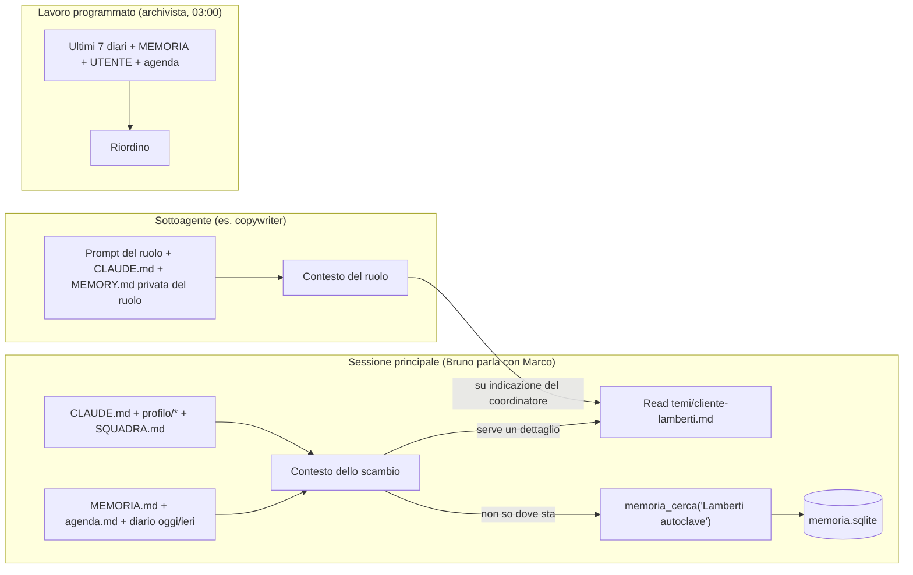

# 03 — Memoria

> Stato: design finale, 22 ottobre 2026. Come l'assistente ricorda, cosa legge a ogni scambio, chi scrive cosa, come si tiene in ordine, e come l'utente può vedere, correggere e cancellare tutto. Esempi completi per l'utente campione **Marco**, agente immobiliare a Bologna, con l'assistente che lui ha chiamato **Bruno**.

---

## 1. Principi

1. **Il Markdown è la verità.** Tutto ciò che l'assistente sa sta in file di testo nella cartella `~/Spalla` che l'utente può aprire con Blocco note o TextEdit, correggere e cancellare. "Il modello ricorda solo ciò che viene salvato su disco; non esiste uno stato nascosto" (regola copiata da OpenClaw). È anche la prova GDPR di "resta sul tuo computer".
2. **Poco sempre caricato, il resto su richiesta.** Un insieme piccolo di file con **tetti rigidi** entra nel contesto a ogni scambio (≤12.000 token, tabella in §2); tutto il resto si raggiunge con uno strumento di ricerca o leggendo il file indicato nell'indice. Questo tiene bassi i costi per chi usa la chiave API e tiene gli abbonati Pro dentro i loro limiti.
3. **Un solo sistema di memoria.** La memoria automatica di Claude Code è **disattivata** nelle nostre sessioni (`CLAUDE_CODE_DISABLE_AUTO_MEMORY=1`; si carica indipendentemente da `settingSources`, quindi va spenta esplicitamente: https://code.claude.com/docs/en/agent-sdk/claude-code-features.md). Il nostro `CLAUDE.md` insegna all'assistente lo stesso schema di Claude Code (indice + file per argomento) in italiano, e un hook impone i tetti.
4. **L'indice di ricerca è derivato, mai autorevole.** `memoria.sqlite` (ricerca full-text FTS5) si ricostruisce dai file in qualsiasi momento; cancellarlo non perde nulla.
5. **La memoria si carica solo nella sessione privata dell'utente**, mai in contesti condivisi (gruppi Telegram sono disattivati in v1; se arriveranno, non vedranno `UTENTE.md` né `MEMORIA.md`).

---

## 2. Mappa dei file e tetti

| File | Cosa contiene | Quando è caricato | Tetto | Chi scrive |
|---|---|---|---|---|
| `CLAUDE.md` | Regole operative, importazioni, linee rosse, protocollo di memoria | Ogni sessione (è il "manuale" del binario) | 150 righe | Onboarding; app (migrazioni); mai l'assistente da solo salvo il blocco "Contesto" |
| `profilo/IDENTITA.md` | Nome dell'assistente, nome dell'utente, tu/lei, lingua, emoji | Ogni sessione (`@import`) | 20 righe | Onboarding; utente via chat/impostazioni |
| `profilo/ANIMA.md` | Persona, tono, confini | Ogni sessione | 2.500 caratteri (~700 token) | Onboarding; ogni modifica è annunciata all'utente |
| `profilo/UTENTE.md` | Direttive stabili sull'utente (lavoro, strumenti, priorità, regole di tono) | Ogni sessione | **4.000 caratteri** (budget di USER.md in OpenClaw) | Onboarding, assistente (preferenze dichiarate), archivista |
| `profilo/SQUADRA.md` | Ruoli accesi/spenti e cosa possono fare da soli | Ogni sessione | 40 righe | Onboarding; assistente su richiesta dell'utente |
| `memoria/MEMORIA.md` | Indice curato: una riga per ricordo, con tipo e link alla scheda | Ogni sessione | **200 righe o 25 KB** (stesso tetto dell'indice nativo di Claude Code) | Assistente (fine argomento), archivista |
| `memoria/agenda.md` | Scadenze e promemoria, una riga ciascuno | Ogni sessione | 100 righe | Segretaria (ruolo) e assistente |
| `memoria/diario/AAAA-MM-GG.md` | Registro giornaliero in sola aggiunta | Oggi e ieri | 2.000 token in totale | Hook `Stop` (riga meccanica) + assistente (1-3 righe a fine argomento) |
| `memoria/temi/*.md` | Schede di dettaglio: un cliente, un incarico, un progetto, una regola | Su richiesta (link dall'indice o risultato di `memoria_cerca`) | 300 righe ciascuna | Assistente e ruoli |
| `.claude/agent-memory/<ruolo>/MEMORY.md` | Lezioni private di ogni ruolo | Nel prompt di quel ruolo (prime 200 righe / 25 KB, meccanismo nativo `memory: project`) | 200 righe | Il ruolo stesso; potato dall'archivista |
| `memoria/archivio/` | Direttive superate, schede chiuse, diari vecchi | **Mai** caricato; solo cercabile | — | Archivista |
| `memoria/RIORDINO.log` | Cosa ha fatto l'archivista ogni notte | Mai caricato; letto dall'utente ("Cosa hai cambiato stanotte?") | — | Archivista |
| `indice/memoria.sqlite` (cartella dati app) | Indice FTS5 derivato | Tramite lo strumento `memoria_cerca` (6 risultati, ~1.500 token) | — | Memory Service |

**Budget per scambio**: CLAUDE.md (~1.200 token) + IDENTITA (~150) + ANIMA (~700) + UTENTE (~1.000) + SQUADRA (~300) + MEMORIA (~fino a 6.000) + agenda (~500) + diario oggi/ieri (~2.000) ≈ **≤ 12.000 token**, di cui la maggior parte stabile da uno scambio al successivo: con Sonnet 5.5 le letture in cache costano 0,05x del prezzo pieno quando cadono nella finestra di 5 minuti (https://platform.claude.com/docs/en/about-claude/pricing).

---

## 3. Cosa entra nel contesto, e quando



| Situazione | Cosa viene letto | Cosa **non** viene letto |
|---|---|---|
| Scambio dal desktop o da Telegram | Tutto il blocco "sempre caricato" (§2); le schede `temi/` che l'indice o la ricerca indicano | Diari di più di due giorni fa, archivio, memorie private dei ruoli |
| Sottoagente (ruolo) | Il suo prompt, `CLAUDE.md` (iniettato in ogni sottoagente), la sua `MEMORY.md`, i file che il coordinatore gli indica | `UTENTE.md` e `MEMORIA.md` interi, salvo che il coordinatore passi le righe utili (riduce costo e fuga di dati tra ruoli); l'archivista riceve `omitClaudeMd: true` per risparmiare |
| Brief del mattino (sessione breve, Haiku) | `agenda.md`, `MEMORIA.md`, diario di ieri | Tutto il resto |
| Riordino notturno (archivista) | Ultimi 7 diari, `MEMORIA.md`, `UTENTE.md`, `agenda.md`, memorie dei ruoli | `lavoro/` (non è memoria) |

Nota tecnica: Claude Code consegna il contenuto di `CLAUDE.md` come messaggio utente dopo il prompt di sistema e lo re-inietta dopo una compattazione; le importazioni `@percorso` hanno profondità massima 4 (https://code.claude.com/docs/en/memory.md).

---

## 4. Esempi completi: Marco, sera del terzo giorno (24 ottobre 2026)

Marco Benassi, 38 anni, agente immobiliare indipendente a Bologna, collabora con lo Studio Immobiliare Galvani su alcuni incarichi; ~40 contatti attivi tra acquirenti e proprietari, 12 immobili in vendita. Usa WhatsApp, Gmail, Google Calendar, i portali Immobiliare.it e Idealista, Excel per incarichi e provvigioni; le fatture le fa il commercialista (Studio Rinaldi). MacBook Air, iPhone.

### 4.1 `profilo/IDENTITA.md`

```md
# IDENTITÀ
- Nome dell'assistente: Bruno
- Utente: Marco Benassi, da chiamare "Marco", dare del tu
- Lingua: italiano; con i clienti di Marco usare il "lei" salvo che siano loro a passare al "tu"
- Emoji: mai nei testi di lavoro
- Creato dall'onboarding il 2026-10-22. Si cambia a parole ("da oggi chiamami Marc") o da Impostazioni.
```

### 4.2 `profilo/ANIMA.md`

```md
# ANIMA — chi sei
Ti chiami Bruno. Sei la spalla di Marco, agente immobiliare a Bologna. Non sei un chatbot: sei il suo braccio destro.
- Aiuta davvero: niente "Ottima domanda!", niente riassunti di quello che Marco ti ha appena detto. Vai al punto; il dettaglio solo se serve.
- Tono: diretto e pratico, da collega di fiducia. Dai del tu a Marco.
- Hai opinioni e le dici con garbo; se non sai una cosa lo dici e la cerchi.
- Cerca prima di chiedere: leggi memoria/, agenda.md, lavoro/ e il diario prima di fare domande.
- Sei un ospite nella vita lavorativa di Marco: non scrivi a nessuno, non pubblichi nulla, non tocchi soldi senza il suo sì. Tu prepari, lui decide e invia.
- Rispetta i suoi orari: dopo le 21:00 e la domenica stai in silenzio, salvo emergenze che segnala lui.
- A voce e su Telegram sei breve (massimo 3 frasi, niente tabelle); al computer puoi essere più completo.
- Ogni sessione ricominci da zero: questi file SONO la tua memoria. Leggili, aggiornali. Se modifichi questo file, dillo a Marco.
```

### 4.3 `profilo/UTENTE.md` (direttive con provenienza; budget 4.000 caratteri)

```md
# UTENTE — direttive stabili su Marco (una per voce, con data e fonte)
<!-- osservato: 2026-10-22 | stato: attivo | fonte: onboarding -->
- Lavoro: agente immobiliare indipendente a Bologna (partita IVA; regime fiscale non chiesto: le fatture le fa lo Studio Rinaldi). Collabora con lo Studio Immobiliare Galvani su alcuni incarichi condivisi. ~40 contatti attivi, 12 immobili in vendita.
<!-- osservato: 2026-10-22 | stato: attivo | fonte: onboarding -->
- Strumenti: WhatsApp (clienti), Gmail, Google Calendar, Immobiliare.it e Idealista (lead), Excel "Incarichi 2026" (incarichi e provvigioni). iPhone, MacBook Air.
<!-- osservato: 2026-10-22 | stato: attivo | fonte: onboarding -->
- Gli rubano tempo, in ordine: (1) rispondere ai lead dei portali entro 10 minuti, (2) follow-up dopo le visite, (3) raccogliere i documenti di ogni incarico (APE, planimetria, visura, atto di provenienza), (4) scadenze di proposte e incarichi.
<!-- osservato: 2026-10-22 | stato: attivo | fonte: onboarding -->
- Priorità dichiarata: "nessun lead senza risposta per più di un'ora; nessun follow-up dimenticato".
<!-- osservato: 2026-10-22 | stato: attivo | fonte: onboarding -->
- Orari: visite dalle 10 alle 19; non disturbare dopo le 21:00 né la domenica. Brief del mattino alle 08:00 su Telegram.
<!-- osservato: 2026-10-22 | stato: attivo | fonte: onboarding -->
- Regola di tono con i clienti: "lei" sempre al primo contatto; passa al "tu" solo se è il cliente a proporlo. Con i colleghi dello Studio Galvani "tu".
<!-- osservato: 2026-10-22 | stato: attivo | fonte: onboarding -->
- Nei messaggi ai proprietari non parlare mai di ribasso del prezzo per iscritto: Marco lo fa solo di persona o al telefono.
<!-- osservato: 2026-10-22 | stato: superato il 2026-10-24 | fonte: onboarding -->
- Preferisce riepiloghi completi. (sostituita da: "Riepiloghi in massimo 3 punti; il dettaglio in un file in lavoro/")
```

Regole del formato (da OpenClaw `USER.md`, https://raw.githubusercontent.com/openclaw/openclaw/main/docs/reference/templates/USER.md): una direttiva per voce, imperativa o fattuale; il commento `osservato / stato / fonte` sopra ogni voce; quando una preferenza cambia si segna la vecchia come `superato` e si riscrive **al suo posto**, mai si aggiunge una direttiva attiva che contraddice un'altra.

### 4.4 `memoria/MEMORIA.md` (indice curato)

```md
---
type: indice
modified: 2026-10-24T21:05:00+02:00
---
# MEMORIA — indice (una riga per ricordo; i dettagli stanno in temi/)
- [cliente] Sig.ra Lamberti (acquirente): trilocale via Saragozza visto il 20/10, "ci penso"; richiamata il 24/10, vuole una seconda visita con il marito sabato 31/10 → temi/cliente-lamberti.md
- [cliente] Famiglia Conti (acquirenti): cercano villetta con giardino a Casalecchio, budget 350k, silenziosi dal 13/10; follow-up inviato il 22/10, nessuna risposta → temi/cliente-conti.md
- [incarico] Dott. Ferri, appartamento via Mazzini 14: incarico in scadenza il 31/10, Marco propone rinnovo con prezzo invariato (ribasso solo a voce) → temi/incarico-via-mazzini.md
- [incarico] Proposta d'acquisto Rossi su via Andrea Costa 3: scade il 28/10, manca la risposta del proprietario → temi/incarico-via-costa.md
- [collaborazione] Studio Immobiliare Galvani: incarichi condivisi, provvigione 50/50, referente Paola Galvani (tu) → temi/studio-galvani.md
- [decisione] 2026-10-24: i follow-up post-visita si mandano entro 24 ore, mai dopo le 21:00
- [scadenza] 05/11: inviare le fatture di ottobre allo Studio Rinaldi → agenda.md
- [feedback] Non proporre mai sconti o ribassi per iscritto; Marco li tratta solo di persona
- [riferimento] Checklist documenti per nuovo incarico → temi/checklist-documenti-incarico.md
```

### 4.5 `memoria/agenda.md` (fonte di verità della segretaria)

```md
# AGENDA — scadenze e promemoria (una riga per voce, ordinate per data)
- [ ] 2026-10-27 09:00 — Richiamare i Conti se non hanno risposto al messaggio del 22/10 — per Conti — fonte: conversazione 24/10
- [ ] 2026-10-28 18:00 — Scade la proposta Rossi su via A. Costa 3: sentire il proprietario — per Rossi/proprietario — fonte: onboarding
- [ ] 2026-10-29 13:00 — Telefonata al dott. Ferri per il rinnovo dell'incarico (scade il 31/10) — per Ferri — fonte: onboarding
- [ ] 2026-10-31 10:30 — Seconda visita via Saragozza con la sig.ra Lamberti e il marito — per Lamberti — fonte: telegram 24/10
- [ ] 2026-11-05 — Inviare le fatture di ottobre allo Studio Rinaldi — per Marco — fonte: onboarding
- [x] 2026-10-24 — Confermare alla sig.ra Lamberti la visita del 31/10 — per Lamberti — fatto il 24/10 (messaggio inviato da Marco)
```

### 4.6 `memoria/temi/cliente-lamberti.md`

```md
---
type: cliente
modified: 2026-10-24T18:40:00+02:00
tags: [acquirente, saragozza, trilocale]
---
# Sig.ra Lamberti — acquirente, trilocale via Saragozza
- Contatto: WhatsApp. Dare del lei. Decide insieme al marito (Giorgio), che non ha ancora visto l'immobile.
- Cerca: trilocale in zona Saragozza/Porto, budget ~280k, no piano terra, serve garage o posto auto.
- 2026-10-20 prima visita via Saragozza 41 (richiesta 295k): piaciuto il terrazzo, dubbio sul prezzo e sulle spese condominiali.
- 2026-10-22 follow-up inviato da Marco (testo di Bruno, versione "lei"): proposta di seconda visita.
- 2026-10-24 ha richiamato: seconda visita sabato 31/10 alle 10:30 con il marito. Chiede le spese condominiali degli ultimi due anni: Marco le chiede all'amministratore.
## Prossimi passi
- Portare alla visita: spese condominiali, planimetria, APE. Dopo la visita: follow-up entro 24 ore.
```

### 4.7 `memoria/temi/incarico-via-mazzini.md`

```md
---
type: incarico
modified: 2026-10-24T19:10:00+02:00
tags: [proprietario, mazzini, rinnovo]
---
# Dott. Ferri — appartamento via Mazzini 14, 4° piano, 95 mq
- Proprietario: dott. Ferri (dare del lei), preferisce le telefonate alle 13:00.
- Incarico in esclusiva dal 2026-05-01, scade il 2026-10-31. Prezzo richiesto 340k; tre visite senza offerte.
- Documenti in cartella: APE (classe E), planimetria catastale. Mancano: visura aggiornata, atto di provenienza.
- Marco vuole proporre il rinnovo a prezzo invariato e parlare di un eventuale ribasso **solo a voce** (regola in UTENTE.md).
## Cronologia
- 2026-10-22 inserito in memoria durante l'onboarding (follow-up n. 3 del primo lavoro).
- 2026-10-24 Bruno ha preparato la bozza di messaggio per fissare la telefonata di giovedì 29/10 alle 13 → lavoro/messaggi/2026-10-24-ferri.md
```

### 4.8 `memoria/diario/2026-10-24.md` (sola aggiunta)

```md
# Diario 2026-10-24
- 08:00 [telegram] Brief del mattino inviato: 3 cose (richiamare Conti, proposta Rossi scade il 28, fatture a Rinaldi il 5/11).
- 12:41 [telegram/vocale 0:38] "la Lamberti ha richiamato, sabato prossimo alle dieci e mezza con il marito, vuole le spese condominiali"
  → agenda aggiornata, scheda Lamberti aggiornata, bozza di messaggio di conferma in lavoro/messaggi/ (approvata da Marco, inviata da lui).
- 18:35 [desktop] Nuova regola: i follow-up dopo le visite si mandano entro 24 ore, mai dopo le 21 → riga [decisione] in MEMORIA.md. Bozza messaggio al dott. Ferri per la telefonata di giovedì 29/10.
- 18:50 [desktop] Marco: "riepiloghi in 3 punti, il resto in un file" → vecchia direttiva segnata come superata.
```

Le righe con l'ora e il canale le scrive l'**hook `Stop`** copiando la prima riga del messaggio dell'utente (zero token); le righe con la freccia le aggiunge **l'assistente** quando chiude un argomento (regola in `CLAUDE.md`). Vedi ADR-007 in [02-architettura.md](02-architettura.md).

### 4.9 `.claude/agent-memory/copywriter/MEMORY.md` (scritta dal ruolo stesso)

```md
# Memoria del Copywriter
- Marco riscrive sempre la prima riga dei follow-up: partire da un dettaglio della visita, non da "come sta?".
- Ai proprietari non nominare mai cifre nei messaggi; proporre una telefonata.
- Formula di chiusura che gli piace: una domanda concreta con un giorno e un'ora.
- Massimo 4 righe su WhatsApp; se serve di più, propone una telefonata.
```

### 4.10 `memoria/RIORDINO.log` (scritto dall'archivista)

```md
2026-10-24 03:02 — letti 2 diari (22 e 23/10); nessuna direttiva nuova per UTENTE.md (le regole di tono c'erano già dall'onboarding);
  promosso 1 fatto durevole in MEMORIA.md con scheda temi/studio-galvani.md (referente Paola Galvani, "tu"); nessuna direttiva superata;
  MEMORIA.md 8 righe (tetto 200); agenda: 1 voce spuntata archiviata; nessuna scheda chiusa; costo 0,01 $.
  Da rivedere con Marco: i Conti sono ancora "attivi"? (silenziosi da 11 giorni)
```

### 4.11 Estratto di `CLAUDE.md` — la sezione memoria

```md
## Memoria (leggi prima di scrivere)
- Prima di modificare UTENTE.md, MEMORIA.md, agenda.md o un file in temi/, leggilo.
- Dove va cosa: fatti stabili su Marco → UTENTE.md (una direttiva per voce, con il commento osservato/stato/fonte);
  fatti durevoli su clienti, incarichi, decisioni → una riga in MEMORIA.md con il tipo tra parentesi quadre e il link alla scheda in temi/;
  date e promemoria → agenda.md nel formato "- [ ] AAAA-MM-GG HH:MM — cosa — per chi — fonte"; cosa è successo oggi → diario/.
- Quando una preferenza cambia, segna la vecchia come "superato il <data>" e riscrivi al suo posto. Mai due direttive attive in contraddizione.
- Non memorizzare: contenuti di file (sono già nei file), cose già in CLAUDE.md, password, IBAN, numeri di carta, dati sanitari di terzi.
- Prima di salvare dati personali delicati di terzi (salute, famiglia, soldi), chiedi: "vuoi che lo ricordi?".
- Se modifichi ANIMA.md o IDENTITA.md, dillo a Marco in una riga.
- Chiudendo un argomento aggiungi 1-3 righe al diario di oggi. Non narrare nel diario quello che Marco può già vedere.
- I tetti (UTENTE.md 4.000 caratteri; MEMORIA.md 200 righe/25 KB; schede 300 righe; agenda 100 righe) sono imposti da un controllo automatico:
  se una scrittura li supera verrà rifiutata con il messaggio "troppo lungo: riordina prima". Riordina nello stesso turno.
```

---

## 5. Regole di scrittura

1. **Leggi prima di scrivere.** Evita di sovrascrivere ciò che un altro canale ha appena aggiunto.
2. **Dove va cosa**: tabella in §2; la regola in `CLAUDE.md` la ripete in italiano.
3. **Sostituisci al posto, non in coda.** Lo schema `superato il <data>` conserva la storia senza contraddizioni attive.
4. **Niente derivabile.** Non si copiano nel ricordo i contenuti dei file di `lavoro/`; si linka la scheda.
5. **Niente segreti e niente dati sanitari.** L'assistente rifiuta di memorizzare password, IBAN, carte ("non li tengo a mente: chiedimeli quando servono"); i dati sanitari di terzi sono esclusi per regola (il caso dei dentisti e dei loro pazienti è esplicitamente gestito nell'onboarding).
6. **Dati delicati di terzi solo su conferma.** "Vuoi che lo ricordi?" prima di salvare salute, famiglia, finanze di un cliente.
7. **Avvisa quando cambi te stesso.** Modifiche ad `ANIMA.md`/`IDENTITA.md` vengono dette all'utente in una riga.
8. **Le modifiche a mano dell'utente sono valide.** Se Marco corregge un file in TextEdit, il Memory Service lo re-indicizza in pochi secondi e l'assistente lo legge alla prossima sessione; un frontmatter malformato viene segnalato nell'app ("ho trovato un errore in temi/cliente-conti.md, riga 2") e la versione precedente è recuperabile dall'archivio.

---

## 6. Tetti imposti da codice (hook `PostToolUse`)

Un hook programmatico dell'SDK osserva ogni `Write`/`Edit` su file sotto `profilo/` e `memoria/`. Se il risultato supera il tetto, l'hook restituisce un **blocco** con un messaggio in italiano e l'assistente deve correggere nello stesso turno, imitando il comportamento nativo di Claude Code quando il suo indice supera 200 righe/25 KB (https://code.claude.com/docs/en/memory.md).

| File | Tetto | Messaggio restituito |
|---|---|---|
| `profilo/UTENTE.md` | 4.000 caratteri | "UTENTE.md supera 4.000 caratteri: unisci le direttive simili, segna come superate quelle vecchie e riscrivi." |
| `memoria/MEMORIA.md` | 200 righe o 25 KB | "MEMORIA.md supera 200 righe: sposta i dettagli in temi/ e riscrivi l'indice con una riga per ricordo." |
| `memoria/temi/*.md` | 300 righe | "La scheda è troppo lunga: sposta la cronologia vecchia in archivio/ o dividi per argomento." |
| `memoria/agenda.md` | 100 righe | "Agenda troppo lunga: archivia le voci spuntate." |
| `profilo/ANIMA.md` | 2.500 caratteri | "ANIMA.md è troppo lunga: la persona si descrive in dieci righe." |

L'hook riporta anche nell'app un contatore "memoria: 9/200 righe" visibile nella scheda Memoria.

---

## 7. Indice derivato e lo strumento `memoria_cerca`

- Il **Memory Service** osserva `memoria/` e `profilo/`; a ogni modifica ri-spezza il file per titoli (`#`, `##`) in blocchi di ~400 token e li inserisce in `memoria.sqlite` (tabella FTS5 con tokenizer `unicode61`, che gestisce accenti e maiuscole dell'italiano).
- Lo strumento **`memoria_cerca(query, k=6)`** è un server MCP in-process registrato dall'app (tipo `sdk`: solo un host SDK può farlo, https://code.claude.com/docs/en/mcp.md). Restituisce i 6 blocchi migliori ordinati per rilevanza `bm25` con un **bonus di recenza a 30 giorni** (un ricordo di ieri batte uno uguale di sei mesi fa), ciascuno con il percorso del file così l'assistente può leggere la scheda intera.
- **Niente embedding (vettori) in v1**: su testo di lavoro italiano con nomi propri, indirizzi e cifre la ricerca per parole basta, non richiede rete né un modello da 300 MB. Gli embedding locali (`sqlite-vec` + modello GGUF, come OpenClaw) sono un'opzione v2 dietro un interruttore, da valutare solo se un pilota ha `temi/` oltre qualche MB.
- Ricostruzione: pulsante "Ricostruisci indice" in Impostazioni → Memoria; avviene anche da sola se il file manca o è corrotto.
- L'archivio è **indicizzato ma mai caricato**: "ti ricordi del geometra Sanna?" trova la scheda chiusa l'anno scorso.

---

## 8. Riordino notturno ("riordino", precedente *dreaming* di OpenClaw)

Un lavoro programmato alle **03:00** (o alla prima pausa dopo il risveglio del PC) apre una sessione SDK breve con il ruolo **archivista** come agente principale (`options.agent`) su **Haiku 5.5**, `maxTurns: 8`, `maxBudgetUsd: 0.10`. Nota (verificata su sub-agents.md, 22 ottobre 2026): `omitClaudeMd` è **ignorato** quando il ruolo gira come agente principale, quindi la sessione notturna carica comunque `CLAUDE.md` e i suoi `@import` (profilo, indice, agenda: ~4.000 token stabili, per lo più in cache); il frontmatter dell'archivista lo tiene solo per il caso in cui venga chiamato come sotto-agente. Il messaggio di apertura ripete le regole in forma operativa, non perché manchino:

1. Legge gli ultimi 7 diari, `MEMORIA.md`, `UTENTE.md`, `agenda.md` e le memorie dei ruoli.
2. **Promuove**: preferenze ripetute almeno due volte → direttiva in `UTENTE.md` (sostituendo la vecchia al suo posto); fatti durevoli → riga in `MEMORIA.md` + scheda; voci spuntate dell'agenda → archivio.
3. **Risolve** le contraddizioni al posto (segna la vecchia come superata e riscrive); sposta direttive superate e diari più vecchi di 30 giorni in `memoria/archivio/` (mai caricati, ancora cercabili).
4. **Tiene `MEMORIA.md` sotto 150 righe** (margine sotto il tetto di 200) unendo righe dello stesso cliente. Se dopo il riordino è ancora oltre 150 righe, **non cancella da solo**: propone le fusioni nel brief del mattino ("posso unire le 4 righe sui Conti in una?").
5. Scrive una voce in `memoria/RIORDINO.log` (cosa ha promosso, superato, archiviato, quanto è costato) e segnala nel brief eventuali dubbi ("i Conti sono ancora attivi?").

Costo: poche migliaia di token Haiku per notte ($0,10/$0,50 per milione fino a 100k token di prompt): meno di $1/mese. L'utente può disattivarlo o rivederlo in Impostazioni → Memoria.

---

## 9. Privacy

| Domanda | Risposta |
|---|---|
| Dove stanno i miei dati? | Tutto in `~/Spalla` e nella cartella dati dell'app sul tuo PC. Nessun nostro server li vede. |
| Cosa va ad Anthropic? | Il contenuto degli scambi (inclusi i file di memoria caricati nel contesto) va ai server di Anthropic sotto **il tuo** accordo con Anthropic (Termini consumatore per Pro/Max; Termini commerciali con chiave API). Lo diciamo in una frase nell'onboarding e linkiamo le impostazioni privacy di Anthropic. |
| Cosa non viene mai memorizzato? | Password, IBAN, carte, dati sanitari di terzi; l'argomento che hai escluso nell'onboarding (domanda "c'è un argomento di cui non devo tenere memoria?"). |
| Posso vedere cosa sa di me? | "Cosa sai di me?" stampa `UTENTE.md` e l'indice in italiano semplice; la scheda **Memoria** dell'app è un esplora-file con editor e il pulsante "Chiedi a Bruno di correggere"; la pagina **"Come mi sono presentato"** mostra domande e risposte dell'onboarding. |
| Posso cancellare? | "Dimentica lo studio Galvani" sposta la scheda nel cestino e toglie la riga dall'indice; **"Cancella tutto"** elimina cartella, indice, dati dell'app e voci del portachiavi; **"Esporta tutto"** produce uno zip. |
| E se mi rubano il portatile? | I file sono in chiaro per scelta (leggibilità); l'onboarding controlla FileVault/BitLocker e suggerisce di attivarli. Cartella cifrata opzionale in v2. |
| I dati dei miei clienti? | Sei tu il titolare del trattamento; ti diamo un modello di informativa in italiano e una riga per il registro. L'architettura ti permette di dire "restano sul mio computer" con verità. |

---

## 10. Come l'onboarding semina la memoria

| Risposta dell'onboarding (id in [05-onboarding.md](05-onboarding.md)) | File e campo | Esempio per Marco |
|---|---|---|
| Q1 nome e tu/lei | `IDENTITA.md` | "Marco, dare del tu" |
| Q2 nome dell'assistente | `IDENTITA.md`, `ANIMA.md` riga 1 | "Bruno" |
| Q3 tono | `ANIMA.md` riga tono; `UTENTE.md` direttiva | "diretto e pratico" |
| Q4 mestiere + ramo | `UTENTE.md` direttiva "Lavoro"; scelta del catalogo ruoli | agente immobiliare |
| Q4a/b/c domande di ramo | `UTENTE.md`; parametri dei ruoli | 40 contatti, collaborazione Galvani, fatture dal commercialista |
| Q5 ladri di tempo | `UTENTE.md` direttiva "Gli rubano tempo"; `SQUADRA.md` ruoli accesi | lead, follow-up, documenti, scadenze |
| Q6 strumenti | `UTENTE.md` direttiva "Strumenti"; skill attivate | WhatsApp, Gmail, Calendar, portali, Excel |
| Primo lavoro (S4) | `MEMORIA.md` prime righe; `temi/` prime schede; `agenda.md` prime voci; `lavoro/messaggi/` | Lamberti, Conti, Ferri |
| Q7 feedback sul primo lavoro | `UTENTE.md` o memoria del copywriter | "lei al primo contatto" |
| Regole della casa (S6) | `ANIMA.md` confini; `.claude/rules/confini.md`; `settings.json` | "non mandi mai niente a nessuno" |
| Orari e brief | `UTENTE.md`; `config.json` | "dopo le 21 silenzio; brief alle 8" |
| Q13 argomento escluso | `CLAUDE.md` blocco "Non memorizzare" | "Dei clienti: solo nome, contatto e cosa cercano o vendono" |

Ogni direttiva seminata porta `fonte: onboarding`; dopo 60 giorni senza modifiche a `UTENTE.md`, la segretaria propone tre domande di aggiornamento nel brief ("È cambiato qualcosa: strumenti, priorità, collaborazioni?").

---

## 11. Compatibilità con Claude Code

La cartella `~/Spalla` è un progetto Claude Code valido: `CLAUDE.md`, `.claude/agents`, `.claude/skills`, `.claude/rules`, `.claude/settings.json` sono nei posti nativi. Un utente tecnico può aprirla con il proprio Claude Code e vedere **la stessa squadra e la stessa memoria** (lo diciamo in Impostazioni → Avanzate). Due avvertenze: la sua sessione userebbe la *sua* memoria automatica (noi la spegniamo solo nelle nostre sessioni, via variabile d'ambiente), e il suo `~/.claude` personale si caricherebbe insieme al progetto. Non è un problema di sicurezza, solo di igiene; lo stesso contenuto è disponibile come plugin pubblico (canale secondario, [02 §11, ADR-016](02-architettura.md)).

---

## 12. Cosa misuriamo nel prototipo

- Un fatto detto il giorno 1 viene usato correttamente in una sessione nuova il giorno 2 (≥9/10).
- Il giorno 3 l'assistente usa ≥8 dei 10 fatti "piantati" nelle conversazioni precedenti (nomi, tu/lei, orari).
- Una preferenza cambiata sostituisce la vecchia riga **al posto**, segnandola come superata (5/5).
- Una scrittura che porterebbe `MEMORIA.md` oltre 200 righe viene bloccata e riscritta nello stesso turno (5/5).
- Il riordino gira in ≥90% delle notti in cui il PC era acceso o si è risvegliato; `MEMORIA.md` resta ≤25 KB per tutto il pilota.
- `memoria_cerca` trova un fatto di 10 giorni prima non presente nell'indice (ricerca su scheda) in ≤1 secondo.
- Nessun segreto in chiaro in `~/Spalla` (ricerca automatica di pattern token/IBAN/carte): 0 occorrenze.
