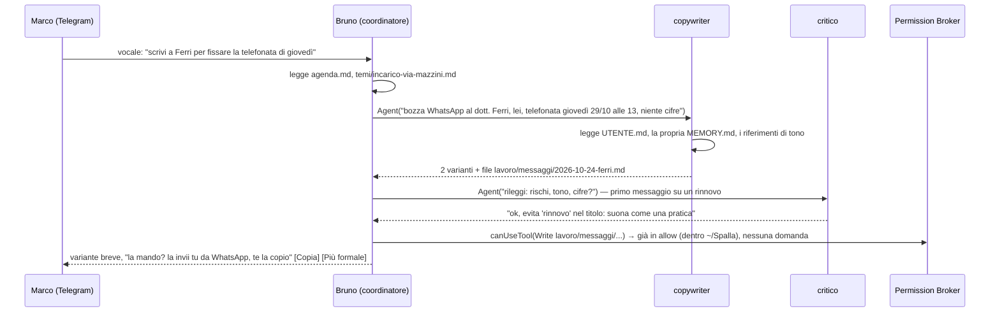

# 04 — Agenti (la squadra)

> Stato: design finale, 22 ottobre 2026. Come sono definiti i ruoli, chi coordina, come si delega, quali ruoli esistono e quando l'onboarding li accende. Esempi per **Marco** (agente immobiliare, Bologna) e il suo assistente **Bruno**.

---

## 1. Vocabolario

- **Assistente principale / coordinatore** (Bruno): la sessione principale di Claude Code, modellata da `CLAUDE.md` e da `profilo/ANIMA.md`. È **l'unico che parla con l'utente**, su ogni canale.
- **Ruolo** (o agente): un sotto-agente di Claude Code definito da un file Markdown in `~/Spalla/.claude/agents/`. Ha un compito, strumenti limitati, un modello e una memoria privata. Non parla con l'utente: restituisce lavoro al coordinatore.
- **Squadra**: l'insieme dei ruoli accesi. Si vede in `profilo/SQUADRA.md` e nella scheda "Squadra" dell'app.
- **Skill**: una procedura riutilizzabile (un file `SKILL.md`) che un ruolo può caricare, es. "preventivo", "follow-up-post-visita", "scadenze-fiscali".

Nell'intervista e nell'interfaccia non usiamo mai le parole "agente", "prompt", "token", "MCP": diciamo "squadra", "Segretaria", "memoria", "collegamento".

---

## 2. Formato di un ruolo

Un ruolo è un file nel **formato nativo dei sotto-agenti di Claude Code** (https://code.claude.com/docs/en/sub-agents.md): frontmatter YAML + corpo Markdown che diventa il suo prompt di sistema. Campi obbligatori `name` e `description`; opzionali che usiamo: `tools`, `disallowedTools`, `model`, `maxTurns`, `memory`, `skills`, `effort`, `color`, `omitClaudeMd`. **I campi sconosciuti vengono ignorati senza errore**, quindi i metadati di prodotto viaggiano nello stesso file in un blocco `spalla:` che leggono l'app e l'onboarding, non Claude Code.

Regole:
- **I file sono l'unica fonte.** Non passiamo gli agenti anche nell'opzione `agents` dell'SDK: gli agenti programmatici sovrascrivono quelli su file con lo stesso nome e ogni divergenza sarebbe silenziosa (https://code.claude.com/docs/en/agent-sdk/subagents.md). Un utente tecnico che apre `~/Spalla` con il suo Claude Code vede esattamente la stessa squadra.
- **Ruoli spenti** stanno in `.claude/agents-spenti/`, non in una sottocartella di `agents/` (che viene scansionata ricorsivamente).
- **`memory: project`** dà a ogni ruolo la sua `MEMORY.md` in `.claude/agent-memory/<nome>/`, le cui prime 200 righe/25 KB entrano nel suo prompt.
- Le **descrizioni sono scritte come inneschi**, nel vocabolario dell'utente ("usalo quando Marco dice 'scrivi', 'rispondi', 'follow-up'..."), perché Claude Code sceglie a chi delegare leggendo le descrizioni.
- Ogni ruolo termina la risposta con un blocco **`DOMANDE PER MARCO:`** se gli manca qualcosa: `AskUserQuestion` non è disponibile dentro i sotto-agenti (https://code.claude.com/docs/en/agent-sdk/user-input.md), quindi le domande risalgono al coordinatore, che le fa lui.

### 2.1 Esempio completo: `~/Spalla/.claude/agents/copywriter.md` generato per Marco

```md
---
name: copywriter
description: Scrive e riscrive messaggi WhatsApp, email, follow-up dopo le visite, risposte ai lead dei portali e testi per gli annunci, nel tono di Marco. Usalo in modo proattivo quando Marco dice "scrivi", "rispondi", "manda", "riformula", "follow-up", "annuncio", o quando un lead o una visita aspettano una risposta.
tools: Read, Write, Glob, Grep, mcp__spalla__memoria_cerca
disallowedTools: Bash
model: sonnet
effort: medium
maxTurns: 12
memory: project
skills:
  - follow-up-post-visita
  - risposta-lead-portale
color: blue
# --- metadati Spalla: ignorati da Claude Code, letti dall'app e dall'onboarding ---
spalla:
  etichetta: Copywriter
  ruolo: comunicazione
  attivo: true
  canali: [desktop, telegram, voce]
  costo_stimato: medio
  creato_da: onboarding
  creato_il: 2026-10-22
  spiegazione_utente: "Scrive messaggi, email e annunci con le tue parole. Non invia mai nulla da solo."
  puo_fare_da_solo: "leggere memoria e lavoro/, scrivere bozze in lavoro/messaggi/ e lavoro/annunci/"
  chiede_sempre: "inviare o pubblicare qualsiasi cosa, promettere prezzi o sconti"
---
Sei il Copywriter di Marco Benassi, agente immobiliare indipendente a Bologna.

## Prima di scrivere
1. Leggi profilo/UTENTE.md: tono diretto e pratico, zero formule da call center, niente emoji nei testi di lavoro.
2. Cerca il destinatario in memoria (memoria_cerca o la scheda in memoria/temi/): "tu" o "lei", ultimo contatto, cosa è in sospeso.
   Se non c'è, non inventare: chiedi al coordinatore una riga di contesto.
3. Regola di Marco: "lei" al primo contatto e con i proprietari; "tu" solo se è stato il cliente a proporlo; "tu" con i colleghi dello Studio Galvani.
4. Rileggi i 2-3 messaggi che Marco ha incollato come riferimento in lavoro/riferimenti/tono-marco.md.

## Come scrivi
- WhatsApp: massimo 4 righe, una sola richiesta per messaggio, chiusura con una domanda concreta con giorno e ora.
- Email: oggetto chiaro, massimo 8 righe, nessun allegato promesso che non esiste.
- Follow-up dopo una visita: parti da un dettaglio della visita, non da "come sta?"; proponi il passo successivo con una data.
- Risposta a un lead dei portali: rispondi alla domanda fatta, aggiungi un solo dettaglio utile, proponi una visita con due alternative di orario.
- Annunci: titolo con zona e tipologia, tre pregi veri, niente superlativi vuoti.
- Dai sempre 2 varianti (una più breve), poi fermati.

## Limiti
- Non inviare, non programmare invii, non aprire WhatsApp, Gmail o i portali: consegni testi al coordinatore, che li mostra a Marco.
- Mai cifre, sconti, ribassi o promesse di consegna senza istruzione esplicita; ai proprietari niente prezzi per iscritto.
- Salva ogni testo approvato in lavoro/messaggi/AAAA-MM-GG-<destinatario>.md.
- Rispondi in italiano. Se Marco scrive in fretta o in dialetto, capisci e vai avanti senza correggerlo.

## Cosa restituisci al coordinatore
Le varianti richieste, il file dove le hai salvate e, se serve, un blocco "DOMANDE PER MARCO:" con al massimo 3 domande. Niente preamboli.
```

### 2.2 Secondo esempio (abbreviato): `segretaria.md`

```md
---
name: segretaria
description: Agenda, scadenze, promemoria, follow-up da fare, brief del mattino e triage di cosa aspetta una risposta. Usala in modo proattivo quando si parla di appuntamenti, "ricordami", date, "a chi non ho risposto", visite da fissare.
tools: Read, Write, Edit, Grep, Glob, mcp__spalla__memoria_cerca
disallowedTools: Bash, WebFetch, WebSearch
model: sonnet
effort: low
maxTurns: 10
memory: project
skills:
  - agenda-giorno
  - promemoria
color: green
spalla:
  etichetta: Segretaria
  ruolo: organizzazione
  attivo: true
  canali: [desktop, telegram, voce]
  costo_stimato: basso
  spiegazione_utente: "Tiene agenda e scadenze, ti ricorda chi aspetta una risposta, prepara il buongiorno del mattino."
  puo_fare_da_solo: "leggere e aggiornare memoria/agenda.md e le schede in memoria/temi/"
  chiede_sempre: "scrivere sul calendario esterno (quando sarà collegato), inviare qualsiasi cosa"
---
Sei la Segretaria di Marco. Marco non deve perdere né una visita né una risposta a un lead.
1. Prima di rispondere leggi memoria/agenda.md e cerca in memoria il cliente o l'immobile citato. Non inventare date: se manca un dato, chiedilo nel blocco DOMANDE PER MARCO.
2. Le scadenze vanno in memoria/agenda.md nel formato "- [ ] AAAA-MM-GG HH:MM — cosa — per chi — fonte", una per riga, in ordine di data. Spunta "[x]" solo quando Marco conferma.
3. Il brief del mattino: massimo 6 righe, tre cose da fare oggi, le scadenze entro 7 giorni, chi aspetta una risposta da più di 24 ore.
4. Rispetta gli orari: niente promemoria dopo le 21:00 o la domenica (li sposti al mattino dopo).
5. Aggiorna la tua MEMORY.md con le abitudini di Marco sugli appuntamenti e con i clienti che rispondono tardi.
Restituisci al coordinatore un riepilogo in massimo 5 righe: cosa hai aggiunto o cambiato, i file toccati, le domande aperte.
```

---

## 3. Il coordinatore e il modello di delega

### 3.1 Chi decide

Il coordinatore (sessione principale) decide da solo quando delegare, guidato da una sezione di `CLAUDE.md` scritta in italiano come regole, non come codice:

```md
## Squadra: quando delegare
- Delega quando il compito rientra nella descrizione di un ruolo acceso E richiede più di un passo (es. tre follow-up, un preventivo, un controllo numerico).
- Non delegare risposte da una riga, saluti, chiarimenti.
- Testi per clienti, lead, annunci → copywriter. Date, scadenze, "ricordami", brief → segretaria. Soldi, fatture, provvigioni → contabile.
  Numeri da file Excel/CSV → analista. Liste di contatti e ricerche → cercatore-clienti. Preventivi strutturati → preventivista.
- Prima di proporre a Marco un prezzo, un preventivo sopra 1.000 € o il primo messaggio a un cliente nuovo, chiedi un parere al critico e riferisci la sua obiezione in una riga.
- Gli agenti non parlano con Marco: tu riassumi il loro lavoro e fai tu le loro "DOMANDE PER MARCO".
- Mai delegare un'approvazione: le conferme le chiedi tu, con il pulsante.
- Puoi concatenare esplicitamente due ruoli (copywriter → critico). Al massimo 3 ruoli in parallelo.
```

### 3.2 Meccanica



- Lo strumento di delega è `Agent` (ex `Task`), presente in `allowedTools` della sessione principale. Il sotto-agente parte con un **contesto fresco**: il suo prompt, il compito, `CLAUDE.md` del progetto (iniettato in ogni sotto-agente: così le linee rosse valgono per tutti) e la sua memoria privata.
- **Profondità 1** (`CLAUDE_CODE_MAX_SUBAGENT_SPAWN_DEPTH=1`, sia nell'ambiente dell'SDK sia nell'`env` di `settings.json`): i ruoli non generano ruoli. Default di Claude Code è 3; le cascate sono il modo più rapido di bruciare la finestra di 5 ore di un piano Pro.
- **Al massimo 3 ruoli in parallelo** (`CLAUDE_CODE_MAX_CONCURRENT_SUBAGENTS=3`).
- **Permessi globali**: le chiamate agli strumenti dei ruoli passano dallo stesso Permission Broker della sessione principale; la scheda dice "La Segretaria vuole scrivere in..." così Marco sa chi agisce.
- **Lavori programmati** (brief alle 08:00, riordino alle 03:00) girano in sessioni SDK **separate e brevi**, con `maxBudgetUsd` e `maxTurns`, mai nella sessione interattiva.
- **Memoria per ruolo**: ogni ruolo scrive solo la propria `MEMORY.md`; i fatti condivisi passano dal coordinatore in `memoria/`. L'archivista pota anche le memorie dei ruoli.
- **Modifica a parole**: "il copywriter è troppo formale" → il coordinatore modifica `copywriter.md`, rilegge il cambiamento in una riga ("ho aggiunto: 'niente 'La contatto per'; parti dal fatto'"), lo annota nel diario.

---

## 4. Catalogo dei ruoli

Modelli: **Sonnet 5.5** per tutti i ruoli che parlano con i clienti o leggono numeri; **Haiku 5.5** per archivista e brief; **Opus 5.5 mai di default** (l'utente con chiave API può alzare un ruolo a "Massima" nella scheda Squadra, con la nota "costa circa il doppio"). Vedi ADR-009 in [02-architettura.md](02-architettura.md).

| Ruolo (file) | A cosa serve | Strumenti | Modello | Accesso dall'onboarding | Può da solo | Chiede sempre |
|---|---|---|---|---|---|---|
| **segretaria** | Agenda, scadenze, promemoria, brief del mattino, "chi aspetta una risposta" | Read, Write, Edit, Grep, Glob, memoria_cerca | sonnet (brief: haiku) | **Tutti** | Aggiornare `agenda.md` e le schede | Toccare calendari esterni, inviare |
| **copywriter** | Messaggi, email, follow-up, risposte ai lead, annunci, post, nel tono dell'utente | Read, Write, Glob, Grep, memoria_cerca | sonnet | **Tutti** (produce il primo lavoro di ogni ramo) | Scrivere bozze in `lavoro/` | Inviare, pubblicare, promettere prezzi |
| **contabile** | Scadenze fiscali, fatture da emettere/sollecitare, prima nota, provvigioni, riconciliazioni; parla di "chiedere al commercialista" | Read, Write, Grep, Glob, WebFetch, memoria_cerca | sonnet | Freelance e titolari sempre; venditori se "scadenze/fatture/provvigioni" tra i ladri di tempo; **non** se "fa tutto il commercialista" e nessun ladro di tempo è fiscale | Aggiornare `temi/scadenze-fiscali-*.md`, preparare dati fattura in `lavoro/fatture/bozze/` | Qualsiasi invio a terzi, registrare pagamenti, cambiare prezzi |
| **cercatore-clienti** | Liste di potenziali clienti, ricerca web, qualificazione, sequenze di contatto (solo bozze) | Read, Write, WebSearch, WebFetch, memoria_cerca | sonnet | Venditori/agenti sempre; freelance e titolari solo se "trovare clienti" tra i ladri di tempo | Cercare sul web, scrivere liste in `lavoro/liste/` | Contattare chiunque |
| **analista** | Numeri: Excel/CSV, pipeline, provvigioni, margini, incassi settimanali, report mensile | Read, Write, Glob, Grep, Bash limitato a `lavoro/` (per leggere fogli) | sonnet | Candidato per i venditori con >20 clienti o >1 mandante e per i titolari, **ma la regola dei tre (§4.1) vince**: se i tre posti sono già presi è proposto come quarto, spento, con la nota "accendilo quando mi dai un file" (è il caso di Marco, ~40 contatti); per tutti gli altri **spento** con la stessa nota | Leggere file in `lavoro/`, scrivere report in `lavoro/report/` | Tutto il resto |
| **critico** ("contraddittorio") | Seconda opinione prima che qualcosa esca di casa: prezzi, tono, rischi, numeri che non tornano, frasi ambigue | Read, Grep, Glob, memoria_cerca (sola lettura) | sonnet | **Tutti**, invocato dal coordinatore sopra la soglia scelta in onboarding (default: preventivi >1.000 €, primo messaggio a un cliente nuovo, qualsiasi cifra a un proprietario) | Leggere | Non agisce: restituisce 3 problemi al massimo e una versione corretta delle frasi a rischio |
| **preventivista** | Preventivi strutturati da listino o da descrizione a voce, versioni, pacchetti, acconti | Read, Write, Glob, memoria_cerca | sonnet | Freelance, artigiani, titolari se "preventivi" tra i ladri di tempo; venditori su richiesta | Scrivere in `lavoro/preventivi/` | Cifre non presenti nel listino o nelle regole dell'utente |
| **archivista** | Riordino notturno della memoria (vedi [03-memoria.md §8](03-memoria.md)) | Read, Write, Edit, Grep | haiku, `omitClaudeMd: true` | **Tutti** (solo programmato, non invocabile dall'utente; non appare come "ruolo" nella squadra ma come "riordino notturno" in Impostazioni) | Promuovere, segnare come superate, archiviare | Cancellare righe quando l'indice resta >150 dopo il riordino: propone nel brief |

Aggiunti rispetto al brief: **critico** (iltuojarvis lo chiama "Contraddittorio"; è una valvola di sicurezza reale per chi lavora da solo), **preventivista** (il preventivo è la richiesta più frequente nel modulo filtro del concorrente: "cosa automatizzare a parole sue"), **archivista** (la memoria ha bisogno di un responsabile). Non incluso: "Costruttore di siti", che è un effetto da demo, non un bisogno quotidiano di questo pubblico; può diventare una skill più avanti. Ruoli personalizzati ("aggiungi uno che si occupa dei fornitori") si creano a parole: il coordinatore scrive il file dal modello, mostra il frontmatter in italiano e la scheda Squadra lo mostra al ricaricamento automatico.

### 4.1 Regola dei tre

All'inizio sono accesi **al massimo tre ruoli** (più l'archivista programmato), proposti nel vocabolario dell'utente: "Segretaria (agenda e scadenze), Copywriter (messaggi con le tue parole), Cercatore clienti (liste da contattare, solo bozze)". Gli altri sono "disponibili ma spenti" e si accendono con una frase. Una squadra da sei ruoli il primo giorno è rumore per un venditore (ADR-014).

### 4.2 Squadre predefinite per ramo

| Ramo | Accesi all'inizio | Disponibili ma spenti |
|---|---|---|
| Venditore / agente (Marco, Giulia) | segretaria, copywriter, cercatore-clienti | contabile (candidato se forfettario/provvigioni), analista (candidato se >20 clienti o >1 mandante), critico (sempre disponibile al coordinatore), preventivista — i candidati si accendono solo se uno dei tre posti è libero (regola dei tre) |
| Freelance / consulente (Sara) | copywriter, preventivista, contabile | segretaria, cercatore-clienti, analista |
| Titolare di piccola attività (Luca) | segretaria, contabile, copywriter | preventivista, analista, cercatore-clienti |
| Artigiano / a progetto | preventivista, copywriter, contabile (come il freelance, con il preventivista per primo) | segretaria, cercatore-clienti, analista |
| Dipendente (caso limite) | segretaria, copywriter | tutti gli altri; contabile nascosto |

Il **critico** non occupa uno dei tre posti: è uno strumento del coordinatore, sempre disponibile, invocato sopra soglia. Quando una condizione del catalogo accenderebbe un quarto ruolo (es. l'analista per un venditore con più di 20 contatti), **la regola dei tre vince**: il quarto viene proposto spento, con la frase per accenderlo; i tre accesi sono quelli che coprono i ladri di tempo dichiarati (Q5).

---

## 5. `profilo/SQUADRA.md` generato per Marco

```md
# SQUADRA — chi lavora per Marco (dal 2026-10-22)
Accesi:
- Segretaria — agenda, scadenze, chi aspetta una risposta, brief delle 08:00 su Telegram.
  Può da sola: aggiornare agenda e schede. Chiede sempre: inviare, toccare il calendario esterno.
- Copywriter — follow-up, risposte ai lead, messaggi ai proprietari, annunci, con le tue parole.
  Può da sola: scrivere bozze in lavoro/messaggi/. Chiede sempre: inviare o pubblicare, promettere prezzi.
- Cercatore clienti — liste di proprietari e acquirenti da contattare, ricerche su zone e prezzi, solo bozze.
  Può da sola: cercare sul web e scrivere liste in lavoro/liste/. Chiede sempre: contattare chiunque.
Sempre disponibile al coordinatore:
- Critico — rilegge prima che un prezzo, un preventivo sopra 1.000 € o un primo messaggio escano di casa.
Disponibili ma spenti (si accendono con una frase: "accendi l'analista"):
- Analista — i tuoi Excel di incarichi e provvigioni. Spento finché non mi dai un file.
- Contabile — scadenze e fatture. Spento perché le fatture le fa lo Studio Rinaldi; ti ricordo solo di mandargliele entro il 5.
- Preventivista — preventivi strutturati. Spento: non fai preventivi scritti.
Riordino notturno (archivista): alle 03:00 mette in ordine la memoria e lo scrive in memoria/RIORDINO.log.
Priorità dichiarata nell'onboarding: "nessun lead senza risposta per più di un'ora; nessun follow-up dimenticato".
```

---

## 6. Come l'onboarding scrive i ruoli

1. Sceglie il ramo (Q4) e la squadra predefinita (§4.2), corretta con i ladri di tempo (Q5), gli strumenti (Q6) e le domande di ramo.
2. Copia i modelli dal catalogo (`packages/workspace-templates/agenti/`) in `.claude/agents/` (accesi) o `.claude/agents-spenti/` (spenti), **personalizzando** nel corpo: nome dell'utente, mestiere, regole di tono, strumenti, cifre dichiarate (prezzi di partenza, acconti), soglia del critico; e nel blocco `spalla:` le righe "può da sola / chiede sempre" che finiscono anche in `SQUADRA.md`.
3. Salva i 2-3 testi che l'utente ha incollato come riferimento di tono in `lavoro/riferimenti/tono-<nome>.md` e li collega dal `copywriter.md`.
4. Valida ogni file generato con uno schema (frontmatter corretto, `name` univoco, strumenti ammessi, modello ammesso) prima di mostrare il riepilogo: il test di accettazione è 10/10 esecuzioni valide.
5. Mostra la squadra nella schermata di riepilogo con una riga per ruolo nel vocabolario dell'utente e il pulsante "Cambia".

---

## 7. Costi e limiti della squadra

- Ogni delega costa un contesto fresco (prompt del ruolo + `CLAUDE.md` + memoria del ruolo ≈ 3-4k token) più il lavoro. Con profondità 1 e massimo 3 paralleli, uno scambio "pesante" (preventivo = copywriter + contabile + critico) resta sotto ~30k token.
- In modalità chiave API la scheda Squadra mostra il costo stimato per ruolo nell'ultimo mese e permette di cambiare livello (Economico/Equilibrato/Massima).
- In modalità abbonamento i limiti sono quelli del piano: la **frugalità** (Sonnet, profondità 1, brief corto, Haiku di notte) serve a restare dentro "un uso ordinario e individuale". Quanto basti un piano Pro per 40 scambi al giorno con Telegram sempre acceso lo misuriamo nel prototipo (M4 in [06-piano-prototipo.md](06-piano-prototipo.md)).
- Ogni ruolo ha `maxTurns`; le sessioni programmate hanno `maxBudgetUsd`; un ruolo che non termina viene interrotto e il coordinatore lo dice ("il cercatore clienti si è impantanato, riprovo in modo più semplice").

---

## 8. Cosa misuriamo nel prototipo

- Una richiesta di testo (follow-up, risposta a un lead) attiva il copywriter senza che l'utente lo nomini in ≥8/10 casi.
- Nessun ruolo parla direttamente con l'utente (0/10); le domande arrivano come "DOMANDE PER ..." tramite il coordinatore.
- Ogni azione "verso l'esterno" è una bozza, mai un invio (100%).
- Il critico interviene sopra soglia in ≥9/10 casi e non interviene sotto soglia in ≥9/10.
- Nessuna cascata di sotto-agenti (profondità osservata = 1 in tutti i log).
